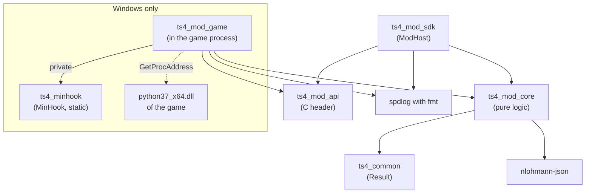
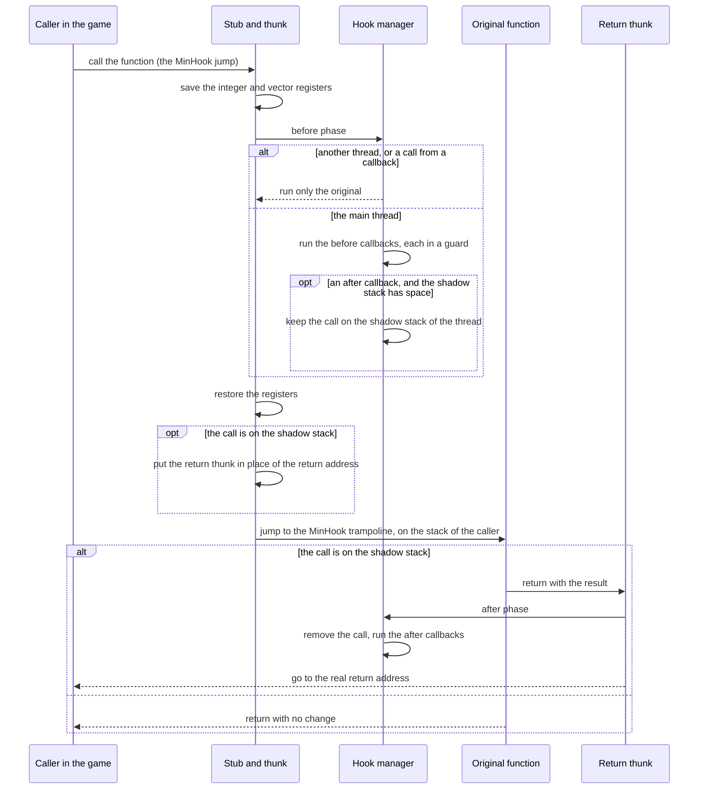
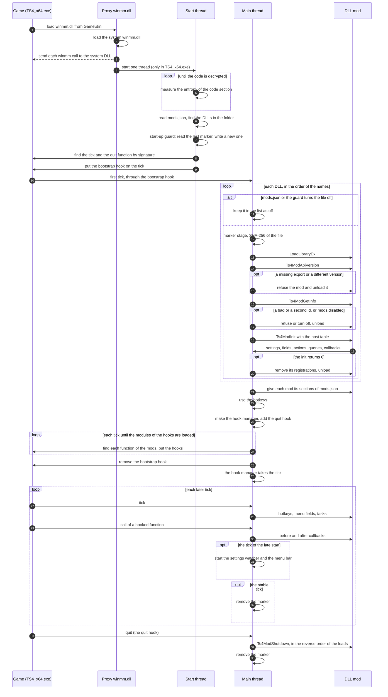
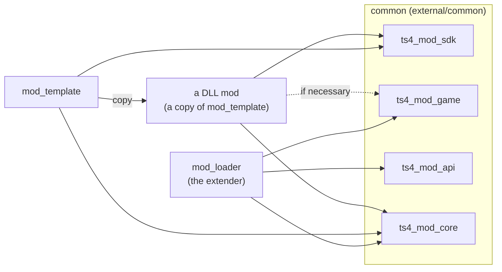

# The design of common

In this file, `<workspace>` is the folder that holds `projects`: this repository is `<workspace>\projects\common`,
and a worktree of it is `<workspace>\worktrees\<name>`. The environment variable `TS4_WORKSPACE` can give another
folder.

The code is a port of the shared code of the Masters of Albion mods (`projects/common` of that workspace) for this
game. The Unity and IL2CPP parts are not in it: a native function of the game has a signature in place of a managed
method.

## What is in it

| Library | Folder | What it does |
|---|---|---|
| `ts4_common` | `src/common` | `ts4::Result` (headers only) |
| `ts4_mod_core` | `src/mod_core` | Pure logic that does not need the game: the game version, frame callbacks, main-thread tasks, the slot swap of a code pointer, hotkeys (with the Windows virtual-key codes), the settings file, the menu field tables, the folders of the mods, the start-up guard, the crash dump rules and the signatures |
| `ts4_mod_api` | `src/mod_api` | `mod_api/Ts4ModApi.h`: the C interface between the extender and a DLL mod |
| `ts4_mod_sdk` | `src/mod_sdk` | The C++ side of that interface in a DLL mod (`ModHost`, `BindFields`, the log sink `HostLogSink`) |
| `ts4_mod_game` | `src/mod_game` | Windows only: the parts that run in the game process. The modules of the game, the signature scan, the decryption check, the hooks (MinHook), the hotkey input, the crash dumps, the status of a mod and the Python 3.7 C API of the game |

The diagram shows the links between the libraries. An arrow points to a library that the source library uses. The
dashed arrow is not a link: `ts4_mod_game` finds the Python functions in the DLL of the game when it runs.



Each library has one folder under `src`, with its headers and sources directly in it. The folder name is the target
name without `ts4_`. Each library puts `src` on the include path, so an include line names the library folder and the
file, for example `#include <common/Result.h>` or `#include <mod_core/Signature.h>`. The folder names of common
start with `mod_` where a mod could have the same name (`core`, `game`), so an include path never finds two files.
The C++ namespaces (`ts4`, `ts4_mod`, `ts4_mod::sdk`, `ts4_mod::settings`) do not follow the folders.

## The Windows parts in the game

`ts4_mod_game` (`src/mod_game`, only on Windows) holds the parts of the extender and the DLL mods that run in the
game process. It is a port of `mod_game` of the Masters of Albion mods, with no IL2CPP and no managed code:

| File | What it does |
|---|---|
| `Module.h` | `ModuleImage`: a loaded module by its name (`TS4_x64.exe`, `Simulation_x64.dll`), its base, and a span over its image and over each section. `ReadImageLayout` reads the PE headers with a check of each bound and returns an error for a bad header. |
| `Scan.h` | `FindUniqueSignature` over the executable sections of a module: the address of the one match, or an error that names the signature and tells the count. `CheckDecrypted` measures the entropy of `.text`, so the extender does not scan `TS4_x64.exe` before the activation wrapper of EA decrypts it. |
| `Hooks.h`, `HookThunk.asm` | `HookManager`: the one owner of the native hooks. One MinHook hook for each function, callbacks before and after the function with `Ts4Call` (at most four integer parameters and an integer result), a guard around each callback, and the removal of each hook when the manager goes out of scope. An x64 thunk (`HookThunk.asm`) keeps every argument of the hooked function, so a function with more than four arguments, a floating-point argument, or a floating-point result works. The callback still reads at most four integer parameters. |
| `Guard.h` | `GuardedCall`: a call that catches a C++ exception and a fault (an access violation, a bad instruction). A fault in a callback stops only the callbacks of its owner. |
| `HotkeyInput.h` | The hotkeys of `mod_core/Hotkey.h` from the key state of Windows: one action for each press, exact modifier keys, nothing while another process has the keyboard. |
| `CrashDump.h` | A minidump when a thread fills its stack or when a guard catches a fault. The dumps go to the log folder, and the writer refuses a folder in the game folder. |
| `ModStatus.h` | The state of one mod for the inspector and the log. |
| `Python.h` | `PythonApi`: the `Py*` exports of the loaded `python37_x64.dll`, which it finds one time with `GetProcAddress`. `GilGuard` holds the GIL, `PyRef` owns a reference, and each Python exception becomes a `Result` error. A missing export turns off only its group of functions. |

The code uses no RVA: a function of the game comes from a signature in its module. The messages on the screen of
the game (`GameMessages` of Masters of Albion) are not in this library, because they need the UI of this game.

MinHook comes from its source archive (`cmake/ModMinHook.cmake`, target `ts4_minhook`) and builds as a static library,
because the vcpkg port of MinHook is a DLL. The archive goes into the download folder of vcpkg on the first configure.

The hook thunk (`HookThunk.asm`, MASM `ml64`) keeps the arguments of a hooked function. MinHook makes the game jump
to a stub for the hook place. The stub goes to a common thunk. The thunk saves the integer registers and the vector
registers. It runs the callbacks of the before phase through a C++ dispatcher. Then it restores the registers and
jumps to the MinHook trampoline. The original function runs on the stack of the caller. Thus the stack arguments and
the vector arguments stay in place, and a floating-point result comes back with no change.

A hook with a callback of the after phase needs the result of the call. The thunk puts a return thunk in place of
the return address. It keeps the call on a per-thread shadow stack with a bound. The original function returns into
the return thunk. The return thunk runs the callbacks of the after phase. Then it goes to the real return address. A
very deep recursion that goes past the bound runs only the original function for the deeper calls.

Limit: a function that does not return in the normal way must not have a callback of the after phase. For example, the
function throws a C++ exception, or another function unwinds the stack through it. The exception goes to the caller
with no change. But the return thunk does not run. Thus the after callbacks of that call do not run, and the call
keeps its place on the shadow stack until the thread uses that place again. A hook with only a before callback takes
the fast path with no shadow stack, so an exception through it is safe.

The diagram shows one call of a hooked function. The callbacks run only on the main thread of the hook manager. A
call on another thread, or a call of the same function from one of its callbacks, runs only the original function.



## The interface between the extender and a mod

`src/mod_api/Ts4ModApi.h` is a versioned C interface (`TS4_MOD_API_VERSION`, now 1), on the model of the Masters of
Albion mod loader. Only plain C types go across it, because the extender and each mod have their own C runtime and
their own copy of the standard library.

A DLL mod exports `Ts4ModApiVersion`, `Ts4ModGetInfo`, `Ts4ModInit` and `Ts4ModShutdown`. The extender refuses a mod
with a different interface version. If `Ts4ModInit` returns 0, the extender removes the registrations of the mod,
unloads it, writes the reason to the log, and the game continues.

The diagram shows how the extender (the `mod_loader` project) starts and loads the DLL mods. The DLL mods are in the
folder `dlls` next to `mods.json`. Each failure that the diagram does not show turns off only its part and writes one
line to the log.



The table of the extender (`Ts4HostApi`) gives:

- the versions and the folders: `loaderVersion`, `gameVersion` (for example `1.128.90.1030`), `gameFolder`,
  `userFolder` (`Documents\Electronic Arts\The Sims 4`), `settingsFolder` and `logFolder`;
- `log`;
- `addFunctionCallback`: a callback before or after a native function;
- `postTask`: a task on the main thread;
- `addSettings` and `saveSettings`: the sections of `mods.json`;
- `addField`, `addAction` (with a hotkey), `addReadout` and `setStatusReader`: the menu bar;
- `showMessage`: a message on the screen of the game;
- `addQuery`, `listQueries` and `callQuery`: the inspector queries.

The extender can add functions at the end of `Ts4HostApi` with no change of the version. A mod checks `size` with
`TS4_HOST_API_HAS` before it uses a function after `TS4_HOST_API_FIRST_SIZE`. `ModHost::Check` refuses a table that is
smaller than the table of the first extender of version 1, and accepts a larger table of a newer extender.

### Function callbacks

The extender owns each hook. A mod never writes a code pointer or a byte of the game. It asks for a callback with a
`Ts4FunctionDesc`:

- the module: `TS4_MODULE_GAME` (`TS4_x64.exe`) or `TS4_MODULE_SIMULATION` (`Simulation_x64.dll`);
- a name for the log;
- the signature text of the first bytes of the function: two hex digits for each fixed byte and `??` for any byte;
- the number of parameters that the callback reads (0 to 4).

The extender installs one hook for each function and calls the callbacks of all mods in order, before or after the
function. It refuses a signature that matches no place or more than one place in its module. No code uses an RVA.
Callbacks on game Python functions come later, at the end of the table.

`mod_core/Signature.h` reads a signature text (also at compile time with `MakeSignature`, which stops the compile on
a bad text) and finds each match in a span of bytes. `FindUniqueSignature` gives the one match or an error.

### Inspector queries

A mod can add named queries (for example `sims.needs`) with `addQuery`: a C function that gets the parameters as JSON
text and gives the answer as JSON text through `Ts4Text`. The extender calls a query on the main thread. A mod lists
the queries of all mods with `listQueries` and calls one with `callQuery`, so the state of each mod stays in its own
DLL. In C++, `ModHost::AddQuery`, `ListQueries` and `CallQuery` do this.

### The folders of the mods

`MakeModFolders` (`mod_core/Folders.h`) puts the settings file, the log files and the marker file of the start in
`%LOCALAPPDATA%\Sims4Mods` (`mods.json`, `logs`, `startup-marker.json`). The environment variables
`TS4_MODS_SETTINGS` and `TS4_LOADER_LOG_FOLDER` can give other paths. It refuses each path in a game folder, because
the extender never writes into the game folder.

## Build

Requirements: Visual Studio with the C++ tools, and the vcpkg checkout `<workspace>\vcpkg`.

```bat
tools\preset.bat x64-release
```

The script prepares the MSVC x64 environment, then configures, compiles and tests the preset `x64-release`
(Ninja, MSVC, RelWithDebInfo). The steps are also available alone: `tools\preset.bat x64-release configure`,
`compile` or `test`.

The dependencies come from vcpkg in manifest mode (`vcpkg.json`): nlohmann-json, spdlog (with fmt) and GoogleTest,
with the triplet `x64-windows-static`. Every DLL that goes to the game uses the static C runtime, so no other DLL
goes there. The presets find these folders from the parent folder of the source folder (`${sourceParentDir}` is
`<workspace>\projects` or `<workspace>\worktrees`), so a repository and its worktrees use the same folders:

- `VCPKG_ROOT` = `<workspace>/vcpkg`,
- `VCPKG_DEFAULT_BINARY_CACHE` = `<workspace>/cache/vcpkg-archives`,
- `VCPKG_DOWNLOADS` = `<workspace>/cache/vcpkg-downloads`.

## Use in a mod project

```sh
git -c protocol.file.allow=always submodule add ../common external/common
```

```cmake
add_subdirectory(external/common)
target_link_libraries(my_mod PRIVATE ts4_mod_sdk)
```

The extender also links `ts4_mod_game` for the hooks, the scan and the Python C API. It can include
`external/common/cmake/ModMinHook.cmake` for its own use of MinHook: the file makes `ts4_minhook` only one time.

The diagram shows how the projects use common. Each project has common as the submodule `external/common`. A DLL
mod that needs the hooks, the scan or the Python C API in its own code also links `ts4_mod_game`.



The submodule URL `../common` is relative to the URL of the mod repository, so it also works for a remote of the same
organization. A local clone with no remote keeps the absolute path of `<workspace>\projects\common` in
`submodule.external/common.url` of its own `.git/config` (`git submodule init` writes it). Git refuses local file
submodules by default, so each submodule command needs `-c protocol.file.allow=always`. The project of the mod sets
`CMAKE_MSVC_RUNTIME_LIBRARY` to the static C runtime and uses the same vcpkg triplet.

## Tests

The tests (GoogleTest, `tests/`) cover the pure parts with fakes, never with the game or game data.
`ctest --preset x64-release` runs them.

The tests of `ts4_mod_game` use the test exe itself: its PE headers and sections, a function with known bytes in a
section of code for the signature scan, and functions of the exe for the hooks. The tests of `Python.h` load the
Python 3.7 of the developer (the same version as the game) and start it in the test process. The environment variable
`TS4_PYTHON37` gives its folder; if it is not set, CMake asks the Python launcher (`py -3.7`) at the configure step.
If CMake finds no Python 3.7, GoogleTest skips these tests. No test loads a file from the game folder.
